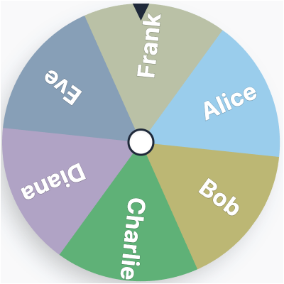

# Spin & Time



Spin & Time is a React + TypeScript browser app for picking a random learner from a class list, built to be screen-shared in a live session.

## What It Does

- Spins a wheel to pick someone, and takes them out of the draw straight away. No timer needed, nothing to close.
- Keeps the latest pick highlighted on the wheel until the next spin, so the pointer still lands on their slice.
- **Put back on wheel** returns the pick to the draw if they're away or want to pass.
- Shows two lists, *Still to go* and *Done*. Click a name to move it between them (e.g. someone volunteered).
- Has an optional speaking timer (30s / 1:00 / 1:30 / 2:00) that is silent and stays on screen at 0:00 until you move on.
- Remembers the class list, who has had a turn and the timer length in this browser, so a refresh mid-session loses nothing.
- Keyboard: `Space` spins, `T` starts or pauses the timer.

## Requirements

- Node.js 20 or newer
- npm
- A modern desktop browser

## Download And Run

1. Clone the repository:

   ```bash
   git clone https://github.com/willbaldlygo/AIWP-Selector.git
   cd AIWP-Selector
   ```

2. Install dependencies:

   ```bash
   npm install
   ```

3. Start the development server:

   ```bash
   npm run dev
   ```

4. Open the local URL shown in the terminal, usually [http://localhost:5151](http://localhost:5151).

## macOS Quick Launch

If you want the app to open straight away in Google Chrome on macOS, use either of these:

```bash
npm run dev:chrome
```

Or double-click [`Launch Spin & Time.command`](./Launch%20Spin%20%26%20Time.command).

## How To Use The App

1. Click `Edit names`, paste one name per line (or a comma-separated list), and save. Duplicates are ignored.
2. Press `Space` or click `Spin`. The picked name moves to *Done*.
3. Optionally press `T` to start the timer.
4. Spin again for the next person. When everyone has had a turn, click `Start a new round`.

## Available Scripts

- `npm run dev` starts the Vite dev server.
- `npm run dev:chrome` starts the dev server and opens Google Chrome on macOS.
- `npm run build` creates a production build in `dist/`.
- `npm run preview` serves the production build locally.

## Project Structure

- `App.tsx` holds the class list, who's done, the current pick and spin logic, and keyboard shortcuts.
- `components/Wheel.tsx` renders the SVG wheel, sizing each label to fit its slice.
- `components/SpeakerPanel.tsx` shows the current pick and the optional timer.
- `components/RosterPanel.tsx` shows the *Still to go* and *Done* lists.
- `components/NamesEditor.tsx` is the class list editor.
- `hooks/useTimer.ts` is a countdown that stays accurate in background tabs.
- `hooks/useStoredState.ts` keeps state in `localStorage`.

## Deployment

The repository includes [`.github/workflows/deploy.yml`](./.github/workflows/deploy.yml) for GitHub Pages deployment from `main`.

To deploy manually:

1. Push your changes to `main`.
2. Open the repository `Settings` on GitHub.
3. In `Pages`, set the source to `GitHub Actions`.
4. The workflow will build the app and publish the contents of `dist/`.

## Notes

- No environment variables are required.
- Names are stored only in the browser you use (`localStorage`). Nothing is sent anywhere.
- There are no sound effects, so nothing competes with learners' audio on a call.
